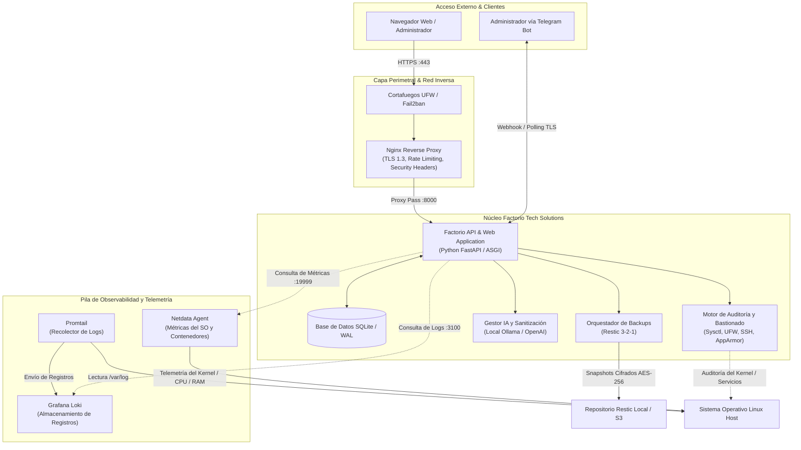

# Factorio Tech Solutions 🛡️⚙️

> **Plataforma Integral de Gestión, Bastionado y Monitorización de Servidores Web Linux para PYMEs.**

[](LICENSE)
[](https://www.python.org/)
[](docs/seguridad-hardening.md)
[](docs/despliegue.md)

---

## 📌 Descripción del Proyecto

**Factorio Tech Solutions** es una solución diseñada específicamente para Pequeñas y Medianas Empresas (PYMEs) que necesitan desplegar, asegurar, auditar y monitorizar servidores web Linux (Ubuntu Server) de forma centralizada, robusta y accesible sin requerir un departamento masivo de ciberseguridad dedicado.

La plataforma combina un backend de gestión reactivo, un panel de control intuitivo, capacidades de auditoría de seguridad automatizada, orquestación de copias de seguridad criptográficas inmutables (Restic), monitorización en tiempo real (Netdata y Grafana Loki) y un asistente inteligente de soporte técnico integrable con modelos locales (Ollama) o en la nube (OpenAI) y notificaciones seguras en Telegram.

---

## 🏛️ Diagrama de Arquitectura



---

## ✨ Características Principales

- **Gestión y Bastionado de Servidores (Hardening Automatizado):**
  - Aplicación guiada de directivas de seguridad basadas en guías CIS Benchmark.
  - Configuración automática de cortafuegos UFW y jaulas de baneo Fail2ban.
  - Blindaje del servicio OpenSSH (desactivación de contraseñas, cambio de puerto, autenticación por llave pública).
  - Configuración de perfiles AppArmor y auditoría con auditd.
  - Ajustes de seguridad en el Kernel vía `sysctl` contra ataques de red y spoofing.
- **Proxy Inverso Seguro (Nginx Hardened):**
  - Cabeceras de seguridad HTTP completas (HSTS, CSP, X-Frame-Options, X-Content-Type-Options, Referrer-Policy).
  - Limitación de tasa de peticiones (Rate Limiting) para mitigar fuerza bruta y DoS.
  - Cifrado TLS moderno con soporte para Let's Encrypt / Certbot.
- **Copias de Seguridad Criptográficas (Estrategia 3-2-1):**
  - Instantáneas incrementales deduplicadas y cifradas de extremo a extremo con Restic.
  - Verificación periódica de integridad automatizada y procedimientos de recuperación ante desastres (DRP).
- **Observabilidad en Tiempo Real:**
  - Panel de telemetría de rendimiento con Netdata (CPU, memoria, discos, sockets, tráfico).
  - Agregación y búsqueda de logs estructurados con Loki y Promtail.
- **Asistente Inteligente y Notificaciones Seguras:**
  - Diagnóstico asistido por IA compatible con modelos privados locales (Ollama) o API pública (OpenAI).
  - Sanitización estricta de datos previa al envío para evitar filtración de tokens, IPs privadas o contraseñas.
  - Alertas instantáneas y comandos administrativos vía Telegram Bot con lista blanca de usuarios.
- **Modo Demostración / Formativo (Zero Dependencies):**
  - Capacidad de operar en modo aislado (`DEMO_MODE=true`) para pruebas, laboratorios de centros educativos (SMR/ASIR) o entornos sin servicios auxiliares desplegados.

---

## 📋 Requisitos del Sistema

### Entorno de Producción Recomendado
- **Sistema Operativo:** Ubuntu Server 22.04 LTS o 24.04 LTS (instalación mínima recomendada).
- **Procesador:** 2 vCPU / núcleos.
- **Memoria RAM:** Mínimo 2 GB (4 GB recomendados si se ejecuta el stack de observabilidad completo).
- **Almacenamiento:** 20 GB de espacio disponible en disco (SSD preferible).
- **Software:** Python 3.10 o superior, Nginx, Git, Restic.

### Entorno de Laboratorio / Desarrollo
- **Python:** 3.10+ (probado en Python 3.14).
- **Docker & Docker Compose (Opcional para Lab):** Docker 24+ y Docker Compose v2.

---

## 🚀 Inicio Rápido (Modo Desarrollo)

Siga estos pasos para clonar, configurar y ejecutar la solución en modo desarrollo:

```bash
# 1. Clonar el repositorio
git clone https://github.com/factorio-tech/factorio-solutions.git
cd factorio-solutions

# 2. Crear y editar la configuración de entorno
cp .env.example .env
# Configure AUTH_SETUP_TOKEN y SESSION_COOKIE_SECURE según docs/configuracion.md

# 3. Configurar el entorno con el script automatizado
chmod +x scripts/*.sh
./scripts/setup.sh

# 4. Iniciar el servidor de desarrollo
./scripts/start-dev.sh
```

La aplicación estará disponible de forma inmediata en:
👉 `http://localhost:8000`

En el primer acceso, el panel solicita el token `AUTH_SETUP_TOKEN` para crear la
cuenta administradora. Para desarrollo HTTP local, configure
`SESSION_COOKIE_SECURE=false`; en producción con HTTPS debe mantenerse `true`.

El backend ASGI se encuentra en `app.main:app`; también puede arrancarse directamente
desde la raíz del proyecto con:

```bash
.venv/bin/python -m uvicorn app.main:app --host 127.0.0.1 --port 8000
```

La API documentada queda disponible en `/docs`. Sus comprobaciones principales son
`/api/health`, `/api/system/status`, `/api/dashboard`, `/api/security`,
`/api/monitoring`, `/api/logs`, `/api/backups`, `/api/automation` y `/api/settings`.
Los datos sintéticos solo se sirven cuando `DEMO_MODE=true`; en modo real las métricas
y la postura de seguridad se consultan en el host; el historial de métricas se persiste
en SQLite. Logs y snapshots Restic requieren Loki y Restic configurados y devuelven un
error explícito si el servicio no está disponible.

---

## 📂 Estructura del Proyecto

```text
.
├── .env.example                  # Plantilla de variables de configuración
├── .gitignore                    # Reglas de exclusión de control de versiones
├── README.md                     # Documentación principal del proyecto
├── config/                       # Archivos de configuración para servicios del sistema
│   ├── apparmor/                 # Perfiles de confinamiento AppArmor
│   │   └── factorio-profile
│   ├── auditd/                   # Reglas de auditoría del kernel
│   │   └── factorio.rules
│   ├── fail2ban/                 # Configuración de cárceles y filtros
│   │   ├── jail.local
│   │   └── filter.d/factorio.conf
│   ├── logrotate/                # Políticas de rotación de registros
│   │   └── factorio
│   ├── nginx/                    # Bloques de servidor y cabeceras seguras
│   │   ├── factorio.conf
│   │   └── security-headers.conf
│   ├── ssh/                      # Configuración blindada del daemon SSH
│   │   └── sshd_config.example
│   ├── systemd/                  # Servicios y temporizadores del sistema
│   │   ├── factorio.service
│   │   ├── factorio-backup.service
│   │   └── factorio-backup.timer
│   └── ufw/                      # Reglas automatizadas del cortafuegos
│       └── rules.sh
├── deploy/                       # Configuraciones para despliegue
│   └── docker/                   # Entorno de laboratorio contenerizado
│       ├── .env.docker
│       ├── Dockerfile
│       ├── docker-compose.yml
│       ├── docker-compose.dev.yml
│       ├── loki-config.yml
│       └── promtail-config.yml
├── docs/                         # Manuales técnicos y documentación en español
│   ├── arquitectura.md           # Diseño, componentes y justificación tecnológica
│   ├── configuracion.md          # Guía exhaustiva de parámetros .env
│   ├── copias-seguridad.md       # Estrategia 3-2-1, Restic y recuperación
│   ├── despliegue.md             # Guía de puesta en producción y Systemd
│   ├── guia-defensa-smr.md       # Guía para presentación y defensa académica SMR
│   ├── ia-chatbot.md             # Integración con IA, sanitización y Telegram
│   ├── instalacion.md            # Instalación paso a paso en Ubuntu Server
│   ├── limitaciones.md           # Capacidades actuales y roadmap de mejoras
│   ├── monitorizacion.md         # Integración con Netdata y Loki
│   ├── nginx-seguro.md           # Guía de endurecimiento de servidor web
│   ├── pruebas.md                # Estrategia de testing y validación
│   └── seguridad-hardening.md    # Manual completo de bastionado de Linux
├── scripts/                      # Utilidades operativas y automatismos
│   ├── backup.sh                 # Ejecución de copias con Restic
│   ├── check-security.sh         # Auditoría rápida de seguridad del host
│   ├── hardening.sh              # Script interactivo de bastionado del SO
│   ├── restore.sh                # Recuperación asistida de copias
│   ├── run-tests.sh              # Batería de pruebas automatizadas
│   ├── setup.sh                  # Instalador inicial y preparación de entorno
│   ├── start-dev.sh              # Servidor de desarrollo
│   └── verify-backup.sh          # Comprobación de integridad de repositorios
└── tests/                        # Pruebas de integración
    └── test_integration.sh      # Pruebas funcionales y de seguridad
```

---

## ⚙️ Configuración (`.env`)

El archivo `.env` controla el comportamiento de la solución:

| Variable | Valor por Defecto | Propósito |
| :--- | :--- | :--- |
| `APP_NAME` | `Factorio Tech Solutions` | Nombre de la instancia |
| `DEBUG` | `false` | Activa modo depuración |
| `DEMO_MODE` | `true` | Habilita datos sintéticos y simulaciones si faltan servicios reales |
| `AUTH_SETUP_TOKEN` | (obligatorio al crear la cuenta) | Token de un solo uso lógico para el alta inicial del administrador |
| `SESSION_COOKIE_SECURE` | `true` | Requiere HTTPS para enviar la cookie de sesión |
| `SESSION_TTL_HOURS` | `8` | Duración máxima de una sesión |
| `DATABASE_URL` | `sqlite:///./data/factorio.db` | Cadena de conexión de la base de datos |
| `NETDATA_URL` | `http://localhost:19999` | Endpoint de la API de Netdata |
| `LOKI_URL` | `http://localhost:3100` | Endpoint de consulta de Grafana Loki |
| `AI_PROVIDER` | `none` | Proveedor (`none`, `openai`, `ollama`) |
| `RESTIC_REPOSITORY` | `/var/backups/factorio` | Ruta o URI del repositorio de respaldo |
| `RESTIC_PASSWORD` | (vacío) | Clave del repositorio Restic; no se devuelve por la API |
| `RESTIC_BACKUP_PATHS` | `[]` | Lista JSON de rutas absolutas permitidas para copias iniciadas desde el panel |

Consulte [Guía de Configuración](docs/configuracion.md) para conocer todas las variables disponibles.

---

## 🧪 Ejecución de Pruebas

Para ejecutar las pruebas de integridad y comprobar el estado del sistema:

```bash
# Ejecutar suite de pruebas de integración y validación
./scripts/run-tests.sh

# Ejecutar pruebas unitarias del API
.venv/bin/python -m pytest -q tests/test_api.py

# Ejecutar auditoría de seguridad del host
./scripts/check-security.sh
```

Consulte [Manual de Pruebas](docs/pruebas.md) para más detalles.

---

## 🚢 Opciones de Despliegue

1. **Producción nativa con Systemd y Nginx (Recomendada para PYMEs):**
   - La aplicación corre bajo un usuario sin privilegios gestionada por `systemd`.
   - Nginx actúa como terminador TLS y proxy inverso.
   - Detallado en [docs/despliegue.md](docs/despliegue.md).
2. **Laboratorio en Contenedores (Docker Compose):**
   - Levanta el ecosistema completo en minutos (`app`, `nginx`, `netdata`, `loki`, `promtail`).
   ```bash
   cd deploy/docker
   cp .env.docker .env
   # Configure AUTH_SETUP_TOKEN in .env before startup
   docker compose up -d
   ```
   Acceso al laboratorio: `http://localhost:8080` (la API interna no se publica
   directamente; el proxy del laboratorio termina en HTTP, no usar en redes públicas).

---

## 🔒 Consideraciones de Seguridad

- **Principio de Mínimo Privilegio:** Ningún proceso expuesto se ejecuta con privilegios de `root`.
- **Defensa en Profundidad:** Superposición de cortafuegos de red, control de accesos por host, filtrado por comportamiento (Fail2ban), confinamiento de procesos (AppArmor) y cabeceras HTTP restrictivas.
- **Privacidad y Sanitización de IA:** Ningún log ni dato confidencial sale del servidor sin pasar por el módulo de regex de desinfección (mascarado de IPs públicas, contraseñas, tokens bearer, DNI/NIE, correos).
- **Límites de la API actual:** No se ha implementado autenticación de operadores. Por ello, las operaciones de configuración y las acciones administrativas quedan limitadas al modo demo; las acciones en producción y la integración con proveedores de IA responden como no implementadas. No exponga la API directamente a redes no confiables hasta incorporar autenticación y autorización.

---

## 📄 Licencia

Este proyecto está distribuido bajo la Licencia **MIT**. Consulte el archivo `LICENSE` para más detalles.

---

## 👥 Créditos y Autoría

Desarrollado por el equipo de **Factorio Tech Solutions** para el ámbito de administración de sistemas, ciberseguridad y proyectos formativos de Sistemas Microinformáticos y Redes (SMR) / Administración de Sistemas Informáticos en Red (ASIR).
