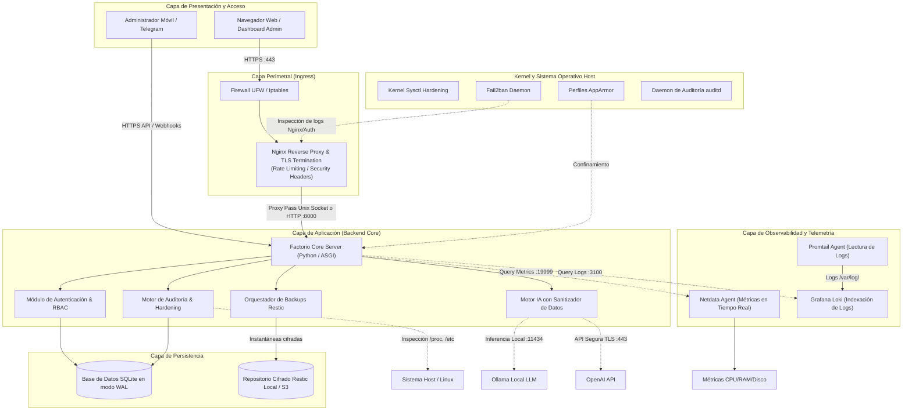

# Arquitectura del Sistema - Factorio Tech Solutions 🏛️

## 1. Visión General del Sistema

**Factorio Tech Solutions** es una plataforma modular y desacoplada concebida para dotar a las pequeñas y medianas empresas (PYMEs) de un panel unificado de gestión de infraestructura, ciberseguridad defensiva, auditoría continua y observabilidad sobre servidores Linux (específicamente optimizado para Ubuntu Server).

El diseño sigue los principios de **DevSecOps**, **Defensa en Profundidad (Defense in Depth)** y **Mínimo Privilegio (PoLP)**, garantizando que cada componente opere en un dominio de aislamiento específico y que las interacciones entre capas sean seguras y auditables.



---

## 2. Descripción de Componentes

### 2.1. Proxy Inverso y Terminador TLS (Nginx)
- **Función:** Es la primera línea de recepción de tráfico HTTP/HTTPS. Realiza la terminación TLS (usando certificados Let's Encrypt o autofirmados para laboratorio), aplica cabeceras de seguridad estrictas (HSTS, CSP, X-Frame-Options) y limita la frecuencia de peticiones (*rate limiting*) para mitigar ataques de fuerza bruta y denegación de servicio superficial.
- **Protocolo:** TLS 1.2 / TLS 1.3 exclusivamente con suites de cifrado modernas (ECDHE-ECDSA-AES128-GCM-SHA256, etc.).

### 2.2. Núcleo de la Aplicación (Factorio Application Server)
- **Tecnología:** Desarrollada en Python utilizando el paradigma asíncrono ASGI para alta concurrencia con bajo consumo de memoria.
- **Responsabilidades:**
  - Exposición de endpoints de control para el dashboard web y la API de administración.
  - Ejecución de diagnósticos del sistema y orquestación de scripts de bastionado.
  - Gestión de autenticación mediante tokens y sesiones seguras con atributos `HttpOnly`, `SameSite=Strict` y `Secure`.
  - Abstracción de modo híbrido: Opera de forma completa sobre un servidor Linux real, o en `DEMO_MODE=true` emulando las llamadas para entornos de laboratorio y docencia formativa.

### 2.3. Motor de Auditoría y Bastionado (Hardening Engine)
- **Función:** Analiza de manera proactiva la postura de seguridad del servidor evaluando:
  - Parámetros de red del kernel en `/proc/sys/net/`.
  - Reglas activas y puertos abiertos en `ufw` y `iptables`.
  - Configuración del servicio SSH (`/etc/ssh/sshd_config`).
  - Estado de las jaulas y baneos de `fail2ban`.
  - Estado del confinamiento obligatorio de procesos (`apparmor_status`).
  - Servicios innecesarios en ejecución (`systemctl list-unit-files`).

### 2.4. Orquestador de Copias de Seguridad (Backup Engine)
- **Tecnología:** Motor basado en Restic.
- **Función:** Implementa una estrategia de respaldo 3-2-1. Realiza instantáneas deduplicadas, cifradas en origen mediante AES-256 en modo GCM o ChaCha20-Poly1305. Permite verificación de integridad mediante comprobaciones SHA-256 periódicas y restauración asistida a nivel de archivo granular o directorio completo.

### 2.5. Pila de Observabilidad (Netdata + Grafana Loki + Promtail)
- **Netdata:** Monitorización de latencia cero para recopilar métricas de CPU, memoria, I/O de disco, ancho de banda de red y conexiones por socket a una resolución de 1 segundo.
- **Grafana Loki & Promtail:** Recopilación ligera de eventos del sistema (`syslog`, `auth.log`, `nginx/access.log`, `nginx/error.log`). A diferencia de Elasticsearch, Loki indexa únicamente etiquetas de metadatos, reduciendo el consumo de memoria en más de un 80%, ideal para PYMEs.

### 2.6. Motor de Inteligencia Artificial y Chatbot con Sanitizador de Datos
- **Función:** Asiste a los administradores de sistemas en el análisis de incidencias, explicación de logs anómalos y sugerencias de comandos de mitigación.
- **Sanitizador de Datos (Data Redactor):** Antes de enviar cualquier consulta o fragmento de log a un modelo de lenguaje (sea local o en la nube), el motor procesa el texto aplicando filtros de expresiones regulares para enmascarar:
  - Claves privadas SSH y certificados.
  - Direcciones IPv4/IPv6 públicas y privadas.
  - Credenciales, contraseñas y tokens Bearer.
  - Datos de carácter personal (correos electrónicos, DNI/NIE).
- **Canal Telegram:** Notificaciones push de alertas críticas (disco lleno, detección de ataque de fuerza bruta) e interactividad básica para consultar el estado del servidor.

---

## 3. Flujo de Datos

### 3.1. Flujo de Peticiones Web y Gestión
```
1. Usuario -> [HTTPS:443] -> Nginx (Terminación TLS, Filtrado de Headers)
2. Nginx -> [HTTP:8000 o Unix Socket] -> Factorio API Server
3. API -> Validación de Sesión y Permisos (RBAC)
4. API -> Consulta a Base de Datos Local SQLite (WAL mode)
5. API -> Respuesta JSON / HTML Renderizado -> Nginx -> Usuario
```

### 3.2. Flujo de Auditoría y Verificación de Seguridad
```
1. Cron / Timer / Petición Manual -> Motor de Auditoría
2. Auditor -> Lectura no intrusiva de ficheros de configuración (/etc/ssh, /etc/ufw)
3. Auditor -> Consulta de estado de servicios vía interfaces D-Bus / systemctl
4. Auditor -> Cálculo de puntuación de seguridad (Score 0-100%)
5. Auditor -> Almacenamiento de informe en DB e histórico de cambios
6. Si Score < Umbral_Crítico -> Notificación inmediata vía Bot de Telegram
```

### 3.3. Flujo de Consulta IA con Sanitización
```
1. Administrador introduce consulta: "¿Por qué falla Nginx con este log?"
2. Submódulo de Sanitización intercepta el prompt y los logs adjuntos.
3. Sanitizador sustituye IPs (ej. 192.168.1.50 -> [IP_REDACTADA_1]) y tokens.
4. Prompt sanitizado se despacha al proveedor (Ollama o OpenAI API).
5. Modelo responde con el análisis técnico y posibles comandos de resolución.
6. Se presenta al usuario la respuesta segura indicando los campos anonimizados.
```

---

## 4. Justificación Tecnológica

| Componente | Opción Seleccionada | Alternativas Evaluadas | Justificación de la Elección |
| :--- | :--- | :--- | :--- |
| **Lenguaje Backend** | Python 3.10+ | Go, Node.js, PHP | Facilidad de integración nativa con librerías del sistema Linux, manipulación de ficheros de configuración, soporte robusto de librerías criptográficas y ecosistema de IA. |
| **Proxy Web** | Nginx | Apache HTTPD, Caddy | Nginx ofrece un rendimiento comprobado, mínimo consumo de recursos bajo concurrencia, madurez en módulos de limitación de tasa y amplia documentación para certificaciones oficiales. |
| **Copia de Seguridad** | Restic | Duplicity, BorgBackup, Tar+GPG | Cifrado seguro por defecto en cliente (inmutable), deduplicación por bloques de tamaño variable, soporte nativo de repositorios locales y nubes S3 sin dependencias complejas. |
| **Métricas** | Netdata | Prometheus + Node Exporter | Netdata se instala en un único binario/paquete, consume menos del 2% de CPU y genera visualizaciones automáticas de alta granularidad sin requerir configuración pesada de dashboards. |
| **Logs** | Loki + Promtail | Elasticsearch + Logstash (ELK) | ELK consume habitualmente más de 2-4 GB de RAM solo en JVM. Loki indexa únicamente metadatos y etiquetas, requiriendo menos de 150 MB de memoria, ideal para servidores reducidos de PYMEs. |
| **Base de Datos** | SQLite (WAL) | PostgreSQL, MySQL | Para un panel de control de servidor único o flota reducida, SQLite con Write-Ahead Logging (WAL) elimina la sobrecarga de mantener un daemon de base de datos escuchando en puertos de red, previniendo vectores de ataque de inyección en sockets externos. |

---

## 5. Responsabilidades por Módulo

- **`core.security`:** Módulo que interactúa con las capas del sistema operativo (SSH, sysctl, UFW, Fail2ban) para aplicar y auditar políticas.
- **`core.backup`:** Ejecutor y validador de instantáneas de Restic, gestión de catálogos y cálculo de checksums.
- **`core.telemetry`:** Interfaz de comunicación con las APIs locales de Netdata y Loki, formateando métricas a la interfaz de usuario.
- **`core.ai`:** Enrutador de peticiones a modelos de lenguaje, sanitizador de cadenas y motor de recomendaciones de comandos.
- **`core.notifier`:** Despachador de notificaciones asíncronas para incidentes críticos vía Telegram.
