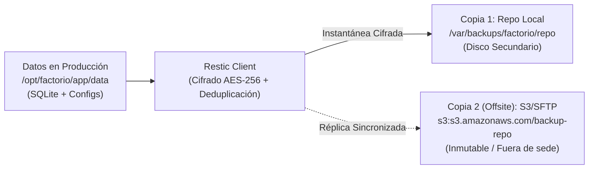

# Guía de Copias de Seguridad y Recuperación (Restic) 💾🔐

Esta guía define la arquitectura, implementación y procedimientos operativos para garantizar la resiliencia de los datos en **Factorio Tech Solutions** mediante el uso de **Restic**, un software de copia de seguridad moderno, seguro, deduplicado y cifrado por defecto.

---

## 1. La Estrategia de Respaldo 3-2-1

Para cumplir con las mejores prácticas de continuidad de negocio y mitigación ante ataques de Ransomware o fallos de hardware, aplicamos la regla **3-2-1**:

1. **3 Copias de los datos:**
   - La copia en producción activa (directorio de datos y base de datos SQLite en `/opt/factorio/app/data`).
   - Una primera copia de seguridad local en un disco/volumen separado (`/var/backups/factorio/repo`).
   - Una segunda copia de seguridad externa / fuera del sitio (*offsite*).
2. **2 Medios o soportes diferentes:**
   - Almacenamiento primario en volumen SSD/NVMe del servidor.
   - Repositorio Restic en un disco de almacenamiento secundario o partición NFS/NAS.
3. **1 Copia fuera del centro de datos (*Offsite* e Inmutable):**
   - Réplica del repositorio cifrado hacia un bucket compatible con S3 (ej. Backblaze B2, MinIO, AWS S3 u OVH Cloud) con bloqueo de objetos (*Object Lock*) para garantizar inmutabilidad ante secuestros de datos.



---

## 2. Instalación de Restic

Restic está disponible en los repositorios estándar de Ubuntu Server:

```bash
sudo apt update
sudo apt install -y restic

# Comprobar la versión instalada
restic version
```

---

## 3. Inicialización del Repositorio de Respaldo

Antes de realizar el primer snapshot, el repositorio debe ser inicializado con una contraseña maestra de cifrado simétrico.

### 3.1. Creación del Directorio Seguro
```bash
# Crear directorio para almacenar el repositorio local
sudo mkdir -p /var/backups/factorio/repo
sudo chown -R factorio:factorio /var/backups/factorio
sudo chmod 700 /var/backups/factorio/repo
```

### 3.2. Inicialización Criptográfica
Exporte las variables requeridas en su entorno o guárdelas en un archivo de credenciales protegido con permisos `600`:

```bash
export RESTIC_REPOSITORY="/var/backups/factorio/repo"
export RESTIC_PASSWORD="ClaveCriptograficaExtremadamenteSegura2026!"

# Inicializar el repositorio
sudo -u factorio -E restic init
```

Salida esperada:
```text
created restic repository a7b89f0123 at /var/backups/factorio/repo
Please note that knowledge of your password is required to access
the repository. Losing your password means that your data is
irrecoverably lost.
```

---

## 4. Procedimiento de Ejecución de Copias de Seguridad

Para asegurar la coherencia de la base de datos SQLite antes de la instantánea, se recomienda ejecutar un vaciado limpio mediante el comando `.backup` de SQLite o aprovechar el modo WAL:

```bash
# 1. Realizar volcado consistente de la base de datos SQLite
sqlite3 /opt/factorio/app/data/factorio.db ".backup '/opt/factorio/app/data/factorio.dump.db'"

# 2. Ejecutar la instantánea de Restic excluyendo ficheros innecesarios
sudo -u factorio -E restic backup \
    --exclude="/opt/factorio/app/.venv" \
    --exclude="/opt/factorio/app/__pycache__" \
    --exclude="/opt/factorio/app/logs/*.log" \
    --tag "daily-backup" \
    /opt/factorio/app/data /opt/factorio/app/.env /opt/factorio/config
```

### Listar Instantáneas Existentes
```bash
sudo -u factorio -E restic snapshots
```

---

## 5. Política de Retención y Poda (*Pruning*)

Para evitar el crecimiento indefinido del disco, se aplica una política de retención automática (*grandfather-father-son*):
- Conservar los últimos 7 respaldos diarios.
- Conservar las últimas 4 semanas.
- Conservar los últimos 12 meses.

```bash
sudo -u factorio -E restic forget \
    --keep-daily 7 \
    --keep-weekly 4 \
    --keep-monthly 12 \
    --prune
```

---

## 6. Procedimientos de Verificación de Integridad

Un backup no comprobado no es un backup válido. Restic permite verificar que los datos cifrados no han sufrido corrupción de bloques o deterioro de disco (*bit rot*):

```bash
# 1. Comprobación estructural rápida de metadatos
sudo -u factorio -E restic check

# 2. Comprobación profunda de datos (lee y recalcula hashes del 5% del volumen cada vez)
sudo -u factorio -E restic check --read-data-subset=5%
```

---

## 7. Procedimiento de Restauración (Disaster Recovery Plan)

En caso de pérdida total o corrupción del servidor:

### 7.1. Restauración Completa de la Última Copia
```bash
# Restaurar la última instantánea en un directorio temporal
mkdir -p /tmp/factorio-restore
sudo -u factorio -E restic restore latest --target /tmp/factorio-restore

# Validar los archivos recuperados
ls -la /tmp/factorio-restore/opt/factorio/app/data
```

### 7.2. Restauración Granular de un Archivo Específico
```bash
# Restaurar solo el archivo .env o la base de datos
sudo -u factorio -E restic restore latest \
    --target /tmp/factorio-restore \
    --include "/opt/factorio/app/.env"
```

### 7.3. Montaje del Repositorio como Sistema de Archivos FUSE
Permite explorar los snapshots de respaldo como si fuesen carpetas normales:
```bash
mkdir -p /mnt/restic-mount
sudo -u factorio -E restic mount /mnt/restic-mount &

# Explorar snapshots
ls -la /mnt/restic-mount/snapshots/
# Desmontar al terminar
fusermount -u /mnt/restic-mount
```

---

## 8. Automatización con Systemd Timers

En lugar de depender del obsoleto daemon `cron`, utilizamos **Systemd Timers**, lo cual proporciona mayor trazabilidad, registros centralizados en `journalctl` y control de dependencias.

Consulte los archivos listos para usar en:
- [config/systemd/factorio-backup.service](../config/systemd/factorio-backup.service)
- [config/systemd/factorio-backup.timer](../config/systemd/factorio-backup.timer)

Habilitación:
```bash
sudo cp config/systemd/factorio-backup.service /etc/systemd/system/
sudo cp config/systemd/factorio-backup.timer /etc/systemd/system/
sudo systemctl daemon-reload
sudo systemctl enable --now factorio-backup.timer

# Verificar próximo disparo programado
systemctl list-timers factorio-backup.timer
```

---

## 9. Pruebas Periódicas de Recuperación (Simulacros DRP)

Se recomienda realizar un simulacro de recuperación cada trimestre:
1. Crear una máquina virtual o contenedor limpio.
2. Descargar el repositorio Restic desde el almacenamiento secundario.
3. Restaurar la base de datos y archivo `.env`.
4. Iniciar la aplicación y comprobar que la interfaz responde con la última información guardada.
5. Documentar el tiempo de recuperación objetivo (RTO) y punto de recuperación objetivo (RPO).
