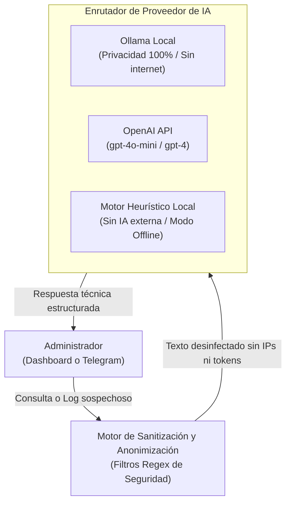

# Guía del Asistente de Inteligencia Artificial y Chatbot 🤖💬

Esta guía detalla el funcionamiento, configuración y salvaguardas de seguridad del motor de Inteligencia Artificial y del bot de Telegram integrados en **Factorio Tech Solutions**.

---

## 1. Arquitectura del Módulo de Inteligencia Artificial

El propósito del asistente IA es ayudar al administrador de sistemas de la PYME a:
1. Interpretar registros de error complejos (Nginx, SSH, syslog, kernel).
2. Diagnosticar problemas de conectividad o sobrecarga de recursos.
3. Proponer comandos de remediación en Linux verificables y seguros.



---

## 2. Motor de Sanitización y Anonimización de Datos (Data Redactor)

**Directriz Crítica de Seguridad:** Ninguna información corporativa sensible, identificador confidencial o clave criptográfica puede ser enviada a un modelo de lenguaje en la nube sin anonimización previa.

El módulo aplica las siguientes transformaciones antes de procesar cualquier entrada:

| Tipo de Dato | Patrón Detectado | Reemplazo Sanitizado |
| :--- | :--- | :--- |
| **Claves Privadas** | `-----BEGIN (RSA|EC|OPENSSH) PRIVATE KEY-----` | `[CLAVE_PRIVADA_REDACTADA]` |
| **Tokens / API Keys** | Cadenas con patrones `sk-[a-zA-Z0-9]{32,}`, `ghp_`, `Bearer ey...` | `[TOKEN_API_REDACTADO]` |
| **Direcciones IPv4 Públicas** | `\b(?:[0-9]{1,3}\.){3}[0-9]{1,3}\b` (No RFC1918) | `[IP_PUBLICA_ANONIMIZADA_1]` |
| **Direcciones IPv4 Privadas** | Redes `10.0.0.0/8`, `172.16.0.0/12`, `192.168.0.0/16` | `[IP_PRIVADA_REDACTADA_1]` |
| **Contraseñas en Línea** | `password=\S+`, `passwd=\S+`, `secret=\S+` | `password=[REDACTADO]` |
| **Correos Electrónicos** | `[a-zA-Z0-9_.+-]+@[a-zA-Z0-9-]+\.[a-zA-Z0-9-.]+` | `[CORREO_REDACTADO]` |
| **DNI / NIE / NIF** | `[0-9]{8}[A-Z]`, `[XYZ][0-9]{7}[A-Z]` | `[DOCUMENTO_ID_REDACTADO]` |

---

## 3. Configuración de Proveedores

### 3.1. Proveedor 1: Deshabilitado / Simulado (`AI_PROVIDER=none`)
Recomendado para entornos sin conexión a internet o sin claves de API disponibles:
```env
AI_PROVIDER=none
AI_API_KEY=
AI_MODEL=
AI_BASE_URL=
```
El motor responderá con una base de conocimiento predefinida en español para los 50 problemas más habituales de administración de sistemas Linux (ej. permisos de Nginx, puertos ocupados, sintaxis de UFW, llaves SSH).

### 3.2. Proveedor 2: Local Privado con Ollama (`AI_PROVIDER=ollama`)
Garantiza privacidad absoluta y cumplimiento del RGPD al ejecutarse íntegramente dentro del servidor:
```env
AI_PROVIDER=ollama
AI_API_KEY=
AI_MODEL=llama3.2
AI_BASE_URL=http://localhost:11434/v1
```
Para poner en marcha Ollama:
```bash
# 1. Instalar Ollama en Linux
curl -fsSL https://ollama.com/install.sh | sh

# 2. Descargar el modelo ligero optimizado para servidores
ollama run llama3.2
```

### 3.3. Proveedor 3: OpenAI (`AI_PROVIDER=openai`)
```env
AI_PROVIDER=openai
AI_API_KEY=sk-proj-tu-api-key-aqui
AI_MODEL=gpt-4o-mini
AI_BASE_URL=https://api.openai.com/v1
```

---

## 4. Bot de Notificaciones y Comandos en Telegram

El bot permite a los administradores recibir avisos en tiempo real e interactuar con el sistema a través de su teléfono móvil.

### 4.1. Configuración de Seguridad en Telegram
1. **Control de Acceso Basado en Identidad:** Solo los IDs de Telegram declarados en `TELEGRAM_ALLOWED_USERS` pueden comunicarse con el bot. Cualquier mensaje de un usuario desconocido es rechazado sin proporcionar información alguna y genera un evento de alerta en el log del sistema.
2. **Sin Ejecución Ciega de Comandos de Shell:** El bot no admite ejecución arbitraria de comandos (`bash`). Solo permite comandos predefinidos de solo lectura o acciones restringidas y seguras.

### 4.2. Comandos Disponibles en Telegram
- `/start` o `/ayuda`: Muestra la lista de acciones disponibles.
- `/estado`: Retorna el estado global del servidor (uptime, CPU %, memoria %, espacio en disco).
- `/seguridad`: Consulta la puntuación de la auditoría de hardening y estado del cortafuegos.
- `/backup`: Consulta la fecha y estado de la última copia de seguridad de Restic.
- `/ia <consulta>`: Envía una pregunta técnica al asistente de IA sanitizado.

---

## 5. Ejemplos Prácticos de Uso

### Ejemplo 1: Diagnóstico de Error 502 Bad Gateway
**Pregunta del Administrador:**
> *"Tengo un error 502 en Nginx al acceder a la web. ¿Cómo lo resuelvo?"*

**Respuesta del Asistente:**
> El error **502 Bad Gateway** indica que Nginx no puede comunicarse con el servicio backend que procesa la aplicación.
>
> **Pasos de resolución recomendados:**
> 1. Compruebe si el servicio de Factorio está en ejecución:
>    ```bash
>    systemctl status factorio.service
>    ```
> 2. Verifique si el backend está escuchando en el puerto esperado:
>    ```bash
>    ss -tulpn | grep 8000
>    ```
> 3. Revise los registros de error de Nginx:
>    ```bash
>    tail -n 20 /var/log/nginx/error.log
>    ```

### Ejemplo 2: Consulta sobre Reglas de UFW
**Pregunta del Administrador:**
> *"¿Cómo permito el acceso SSH solo desde la IP 203.0.113.15 en el puerto 2222?"*

**Respuesta del Asistente:**
> Para restringir el acceso SSH a una IP de gestión específica utilizando UFW:
> ```bash
> sudo ufw allow from 203.0.113.15 to any port 2222 proto tcp comment 'Acceso SSH Admin'
> sudo ufw reload
> sudo ufw status verbose
> ```
