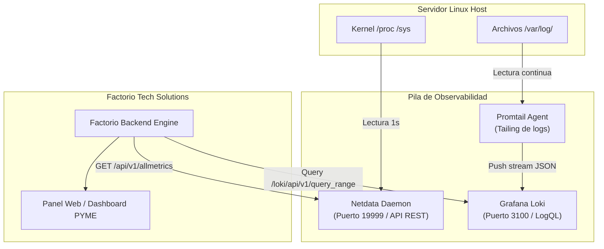

# Guía de Monitorización y Observabilidad 📊📈

Esta guía describe la arquitectura de telemetría de **Factorio Tech Solutions**, compuesta por **Netdata** para métricas del sistema en tiempo real y **Grafana Loki + Promtail** para la agregación centralizada y análisis forense de registros (*logs*).

---

## 1. Visión General de la Pila de Monitorización

En servidores web de PYMEs, las herramientas de monitorización deben cumplir tres requisitos:
1. **Impacto mínimo en recursos:** No consumir más del 2-3% de CPU ni gigabytes de memoria RAM.
2. **Cero configuración pesada:** Ofrecer gráficos y alarmas preconfiguradas desde el primer minuto.
3. **Privacidad estricta:** Almacenar métricas y registros dentro de la propia infraestructura sin obligar a enviar telemetría a plataformas SaaS de terceros.



---

## 2. Netdata: Instalación y Configuración

Netdata es un agente ligero de telemetría que recopila miles de métricas por segundo con impacto inapreciable.

### 2.1. Instalación en Ubuntu Server
```bash
# Instalación del agente Netdata oficial
wget -O /tmp/netdata-kickstart.sh https://get.netdata.cloud/kickstart.sh
sudo sh /tmp/netdata-kickstart.sh --stable-channel --disable-telemetry --non-interactive

# Asegurar que el servicio está activo
sudo systemctl enable --now netdata
```

### 2.2. Endurecimiento de Seguridad de Netdata
Por defecto, Netdata escucha en `0.0.0.0:19999`. Para evitar exponer métricas internas a internet, debe restringirse a `localhost` (`127.0.0.1`):

Edite `/etc/netdata/netdata.conf`:
```ini
[web]
    bind to = 127.0.0.1
    default port = 19999
    allow connections from = localhost 127.0.0.1
```

Reinicie el servicio:
```bash
sudo systemctl restart netdata
```

### 2.3. Endpoints Clave de la API de Netdata Utilizados por Factorio
- `/api/v1/info`: Estado de salud global y versión del host.
- `/api/v1/data?chart=system.cpu`: Uso de procesador detallado (user, system, iowait).
- `/api/v1/data?chart=system.ram`: Desglose de memoria física libre, usada, buffers y cached.
- `/api/v1/data?chart=disk_space._`: Porcentaje de ocupación de las particiones raíz y de datos.
- `/api/v1/alarms?all`: Consulta de alertas activas en el motor de Netdata.

---

## 3. Grafana Loki y Promtail: Agregación de Registros

Grafana Loki es un sistema de almacenamiento de logs de alta eficiencia inspirado en Prometheus, que no indexa el contenido completo del texto sino únicamente etiquetas asociadas (*labels*), reduciendo drásticamente el espacio en disco.

### 3.1. Instalación de Loki y Promtail (Binarios o Docker)
En el entorno de laboratorio se incluye directamente en `docker-compose.yml`. Para una instalación como servicio nativo de Ubuntu:

```bash
# Descargar binarios oficiales de GitHub
LOKI_VERSION="3.0.0"
curl -s https://api.github.com/repos/grafana/loki/releases/latest | grep browser_download_url | cut -d '"' -f 4 | grep "loki-linux-amd64.zip" | wget -i -
unzip loki-linux-amd64.zip
sudo mv loki-linux-amd64 /usr/local/bin/loki

# Crear usuario de sistema para Loki
sudo useradd --no-create-home --shell /bin/false loki
sudo mkdir -p /etc/loki /var/lib/loki
sudo chown -R loki:loki /etc/loki /var/lib/loki
```

### 3.2. Configuración de Promtail para Ingesta de Logs
Promtail monitoriza los archivos del sistema y los transmite a Loki:
- `/var/log/auth.log` (Intentos de autenticación SSH, sudo).
- `/var/log/nginx/access.log` (Peticiones entrantes a Nginx con tiempos de respuesta).
- `/var/log/nginx/error.log` (Errores de conexión o denegaciones).
- `/opt/factorio/app/logs/factorio.log` (Eventos internos de la aplicación).

Fragmento de configuración de Promtail (`promtail-config.yml`):
```yaml
server:
  http_listen_port: 9080
  grpc_listen_port: 0

positions:
  filename: /tmp/positions.yaml

clients:
  - url: http://127.0.0.1:3100/loki/api/v1/push

scrape_configs:
  - job_name: system_auth
    static_configs:
      - targets: [localhost]
        labels:
          job: auth
          host: srv-factorio
          __path__: /var/log/auth.log

  - job_name: nginx
    static_configs:
      - targets: [localhost]
        labels:
          job: nginx
          host: srv-factorio
          __path__: /var/log/nginx/*log

  - job_name: factorio_app
    static_configs:
      - targets: [localhost]
        labels:
          job: factorio
          host: srv-factorio
          __path__: /opt/factorio/app/logs/*.log
```

---

## 4. Reglas de Alerta y Notificación

Factorio evalúa periódicamente las métricas y dispara alertas automáticas:

| Métrica | Umbral de Advertencia | Umbral Crítico | Acción Automatizada |
| :--- | :--- | :--- | :--- |
| **Uso de CPU** | > 80% durante 5 min | > 95% durante 2 min | Notificación Telegram con lista de los 5 procesos con mayor consumo. |
| **Espacio en Disco** | < 20% libre | < 10% libre | Notificación Telegram y ejecución automática de purga de logs antiguos y snapshots podados. |
| **Memoria RAM** | > 85% usado | > 95% usado | Alerta en panel y notificación al administrador. |
| **Intentos SSH Fallidos**| > 5 intentos en 10 min | > 15 intentos en 10 min | Verificación de baneo por Fail2ban y alerta forense. |

---

## 5. Integración con el Panel de Control de Factorio

El backend de Factorio actúa como agregador de la telemetría:
1. En caso de estar configurado `DEMO_MODE=true`, genera curvas realistas para demostraciones formativas y presentaciones.
2. Si `DEMO_MODE=false`, realiza peticiones HTTP locales hacia `NETDATA_URL` (`:19999`) y `LOKI_URL` (`:3100`) y normaliza los datos en un formato amigable para el dashboard HTML del administrador.
